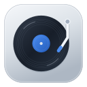
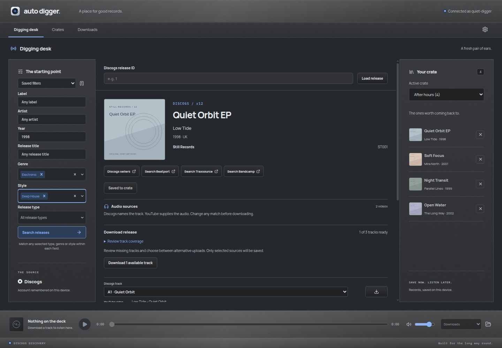

<div align="center">
  
  <h1>Auto Digger</h1>
  <p>Discogs discovery and MCP mix research.</p>
  <p>
    <a href="https://alexanderwanyoike.github.io/auto-digger/">Project site</a> ·
    <a href="#quick-start">Quick start</a> ·
    <a href="docs/user-guide.md">User guide</a> ·
    <a href="https://github.com/alexanderwanyoike/auto-digger/issues">Feedback</a>
  </p>
</div>



_The real desktop app, shown with fictional records and original demo artwork._

Auto Digger is a desktop app for discovering records on Discogs. Connect an MCP client to research mixes and save the original releases to named crates, with matching tracks, tags and source notes. You can also browse releases, preview audio and keep downloaded tracks in a local library.

## Download

[Auto Digger 0.1.1](https://github.com/alexanderwanyoike/auto-digger/releases/tag/v0.1.1) is a desktop preview.

| Platform            | Package                                                                                                                       |
| ------------------- | ----------------------------------------------------------------------------------------------------------------------------- |
| Windows x64         | [Installer](https://github.com/alexanderwanyoike/auto-digger/releases/download/v0.1.1/AutoDigger-0.1.1-windows-x64-setup.exe) |
| macOS Apple silicon | [Disk image](https://github.com/alexanderwanyoike/auto-digger/releases/download/v0.1.1/AutoDigger-0.1.1-macos-arm64.dmg)      |
| macOS Intel         | [Disk image](https://github.com/alexanderwanyoike/auto-digger/releases/download/v0.1.1/AutoDigger-0.1.1-macos-x64.dmg)        |
| Linux x64           | [AppImage](https://github.com/alexanderwanyoike/auto-digger/releases/download/v0.1.1/AutoDigger-0.1.1-linux-x64.AppImage)     |

[SHA-256 checksums](https://github.com/alexanderwanyoike/auto-digger/releases/download/v0.1.1/SHA256SUMS) accompany the installers. Windows builds are unsigned; macOS builds are ad-hoc signed and not notarized.

### Opening the macOS app

Drag **Auto Digger.app** from the disk image into **Applications** first. If macOS blocks the official release with an unverified-app or damaged-app message, quit the app and run this in Terminal:

```sh
xattr -dr com.apple.quarantine "/Applications/Auto Digger.app"
open "/Applications/Auto Digger.app"
```

This removes the download quarantine attribute from that app bundle. Adjust the path if you installed it elsewhere. The builds are ad-hoc signed and not notarized.

See the [setup guide](https://alexanderwanyoike.github.io/auto-digger/setup/#macos) for installation and MCP client help.

Audio previews and downloads need current yt-dlp, FFmpeg, FFprobe and Node.js on your `PATH`. Those audio tools are not bundled. MCP uses the included runtime. Connect a Discogs personal token in the app to start discovering records.

## What you can do

| Feature          | Details                                                                                                                          |
| ---------------- | -------------------------------------------------------------------------------------------------------------------------------- |
| MCP mix research | Let an AI host research a mix, look up Discogs releases and add them to a crate with picked tracks, tags and source notes.       |
| Discovery        | Combine label, artist, year and title with multi-select genres, styles and release types. Browse artwork or draw random matches. |
| Audio            | Preview YouTube sources before downloading. Save tracks or whole releases with progress, retry and best-effort Discogs metadata. |
| Crates           | Keep named collections of releases with track picks and personal tags. The active crate returns after restart.                   |
| Downloads        | Search saved tracks, play them locally and open their folders. Choose flat or per-release file organisation.                     |
| Appearance       | Six materials, seven accents and light, dark or system appearance.                                                               |

## Quick start

To run from source:

### Requirements

- **Node.js 22.16 or later within Node 22**, and **Yarn 1.22.22**.
- A **Discogs personal token** for discovery. The app links to the token settings when you connect.
- Current **[yt-dlp](https://github.com/yt-dlp/yt-dlp#installation)**, **[FFmpeg and FFprobe](https://ffmpeg.org/download.html)** on your `PATH` for previews and audio downloads. Node supplies yt-dlp's JavaScript runtime.
- A desktop session with Electron's system libraries. Headless Linux checks also need Xvfb.

```sh
git clone https://github.com/alexanderwanyoike/auto-digger.git
cd auto-digger
yarn install --frozen-lockfile
yarn dev
```

1. Choose **Discogs not connected**, generate a personal token using the linked settings, and connect in the app.
2. Set your filters and choose **Search releases**, then browse a sleeve or **Dig a random release**.
3. Open a record, check its source-to-track assignments and choose **Preview**. Download the tracks you want to keep.
4. Choose a crate and save the release. Open **Crates** to mark tracks and add tags; use **Downloads** for saved audio.

The token is remembered using operating-system encryption. Disconnecting deletes the saved token. Enter credentials in the app, never in issues, screenshots or project files. No YouTube API key is needed.

See the [user guide](docs/user-guide.md) for source matching, whole-release downloads, account recovery and storage details.

## Your data stays on your desktop

| Data                                                                    | Storage                                                                                   |
| ----------------------------------------------------------------------- | ----------------------------------------------------------------------------------------- |
| Crates, releases, picks, tags, research notes, settings and audio index | `catalog.sqlite` in Electron's `userData` directory                                       |
| Discogs credential                                                      | Separately encrypted `discogs-token.bin` in `userData`                                    |
| Downloaded audio                                                        | Initially `Music/Auto Digger`; future destination and layout are configurable in Settings |
| Audio recovery metadata                                                 | A versioned JSON sidecar beside each downloaded MP3                                       |
| Active crate and appearance mode                                        | Device UI preferences                                                                     |

Saved record metadata and downloaded audio work offline. New Discogs lookups, artwork retrieval and previews need the internet. Close the app before backing up the catalogue and its WAL/SHM companion files; keep audio recovery sidecars with their tracks. Existing `crate.json` data is validated, backed up and imported once.

Auto Digger does not provide cloud sync. The renderer is sandboxed, credentials stay in the main process, and desktop operations use narrow validated IPC boundaries. See [SQLite catalogue ownership](docs/adr/0006-sqlite-catalogue.md) and [account storage](docs/adr/0003-remembered-discogs-account.md).

## Connect your AI assistant

Auto Digger lets Claude or Codex research a mix and save its records to a crate. Set up the connection once on the same computer as Auto Digger.

### Claude Desktop

1. In Auto Digger, open **Settings → Auto Digger MCP** and choose **Enable MCP**.
2. Choose **Save Auto Digger MCP** and save the file in Downloads.
3. In Claude Desktop, open **Settings → Desktop app**, choose **Manage** beside **Extensions**, then **Advanced settings → Install Extension**. Select the saved **Auto Digger MCP.mcpb** file and follow the prompts.

On Linux, use Claude Desktop's official beta for Ubuntu 22.04+ or Debian 12+. Install the file through Claude's settings using the steps above. [Linux installation help](https://support.claude.com/en/articles/10065433-install-claude-desktop).

No terminal commands, configuration files or separate Node installation are needed. Claude supplies the extension's runtime. [Claude's extension installation help](https://support.claude.com/en/articles/10949351-getting-started-with-local-mcp-servers-on-claude-desktop).

### Codex

1. In Auto Digger's research settings, expand **Codex and other local clients** to see the setup fields.
2. In Codex, open **Settings → MCP servers → Add server** and choose **STDIO**. Copy **Command**, then **Argument 1**, **Argument 2** and **Argument 3** into the matching fields. The values are ready to paste.
3. Add the environment variable **ELECTRON_RUN_AS_NODE** with value **1**, then save and restart Codex.

The command uses Auto Digger's included runtime. You do not need to install Node for MCP.

<details>
<summary>Advanced: Codex configuration file and Claude Code</summary>

For Codex CLI, paste the complete **Codex TOML configuration** from Auto Digger into `~/.codex/config.toml`. Replace an existing `[mcp_servers.auto_digger]` block rather than adding it twice. Preserve your other settings.

For Claude Code, register the displayed command with `claude mcp add --transport stdio --scope user auto_digger --env ELECTRON_RUN_AS_NODE=1 --`, followed by the displayed executable and three arguments. Quote paths containing spaces. Use `/mcp` to check the connection.

Other local clients can use **JSON client configuration**. It includes the command, arguments and required environment variable.

[Codex MCP help](https://learn.chatgpt.com/docs/extend/mcp?surface=cli) · [Claude Code MCP help](https://code.claude.com/docs/en/mcp).

</details>

### Try it

Keep Auto Digger open and ask: **Use Auto Digger to list my crates.** Then try:

> Research the mix at [paste a mix URL]. Find the original Discogs releases, save them to a Mix picks crate and mark the matching tracks. Keep source links and flag uncertain matches.

Connect Discogs in Auto Digger for release searches. Your assistant researches the sources; Auto Digger verifies Discogs metadata and saves the results. Review the picks and uncertain matches in **Crates**.

Each time you reopen Auto Digger, choose **Enable MCP** again. Connected assistants can read and edit your crates until you disable access or close the app. Keep your Discogs token in Auto Digger. If you move the app, copy fresh Codex configuration. The [setup guide](https://alexanderwanyoike.github.io/auto-digger/setup/#mcp) includes troubleshooting.

## App updates

The footer shows **Update available** when a newer release is ready. Select it to download, then choose **Restart to update**. Windows installers and Linux AppImages replace the previous app; your crates, settings and music stay in place.

On macOS, the notice opens the installer for your Mac. Install it manually while preview builds use ad-hoc signing. Existing v0.1.1 users need to install this release manually once to gain the updater.

## Development

The app uses Electron, React, strict TypeScript and SQLite. Yarn is the package manager.

| Command                                           | Purpose                                                                  |
| ------------------------------------------------- | ------------------------------------------------------------------------ |
| `yarn dev`                                        | Run the desktop app with live development updates                        |
| `yarn build` / `yarn start`                       | Build and open the production desktop bundle                             |
| `yarn verify`                                     | Check icons, formatting, lint, strict types, tests and production builds |
| `xvfb-run --auto-servernum yarn test:electron`    | Run native Electron checks on headless Linux                             |
| `yarn site:verify` / `yarn site:build`            | Verify and build the GitHub Pages site                                   |
| `yarn site:dev` / `yarn site:preview`             | Develop or preview the site at `/auto-digger/`                           |
| `xvfb-run --auto-servernum yarn site:screenshots` | Capture the real app using an isolated fictional collection              |
| `yarn format`                                     | Format maintained code and documentation                                 |

`yarn dev:web` offers a renderer-only preview. It has no desktop bridge, so it cannot connect to Discogs or save crates. The app bundle is written to `out/`; the static site is written to `site/dist/`.

```text
src/main/       Desktop services, SQLite, credentials and downloads
src/preload/    Validated desktop bridge
src/renderer/   React desk, player and library sections
src/shared/     Domain types, schemas and typed Results
src/mcp/        Local MCP client entry point
site/          Static project site, screenshots and font licences
tests/         Unit/integration fixtures, site checks and native tests
docs/          User guides, architecture decisions and feature specifications
```

Tests use controlled external-service fixtures and isolated profiles, without live credentials or user libraries. Native checks cover playback, downloads, restarts, storage migration, research revocation, keyboard use, layout and appearance contrast. Installer CI checks Windows installation, both macOS disk images and an extracted Linux AppImage with a real MCP client. Interactive Windows/macOS playback and research through a configured AI host remain manual checks.

## Contributing

Start a focused feature branch from `dev` and open its PR against `dev`. Promote `dev` to `main` through a release PR. Use merge commits; squash merging is disabled. Follow the [repository instructions](AGENTS.md), including test-first changes with separate test and implementation commits.

Useful starting points: [domain language](CONTEXT.md), [architecture decisions](docs/adr/), [site publication](docs/project-site.md), and [release preparation](docs/releasing.md).

## Licence and credits

Auto Digger is [MIT licensed](LICENSE). Copyright © 2026 Alexander Wanyoike.

Built on [Discogs](https://www.discogs.com/developers), [yt-dlp](https://github.com/yt-dlp/yt-dlp), [FFmpeg](https://ffmpeg.org/), [Electron](https://www.electronjs.org/), [React](https://react.dev/) and the [Model Context Protocol SDK](https://github.com/modelcontextprotocol/typescript-sdk). Manrope and IBM Plex Mono are distributed under their retained [font licences](site/public/licenses/). Auto Digger is an independent project and is not affiliated with Discogs or YouTube.
