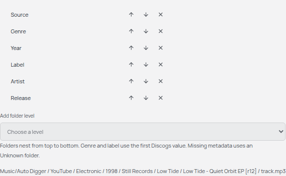
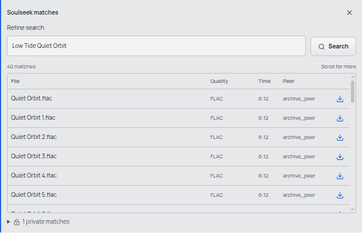

# Soulseek in Auto Digger

slskd runs separately. Auto Digger searches its API and copies completed audio into your normal downloads library.

## 1. Prepare slskd

Use the [official Docker guide](https://github.com/slskd/slskd/blob/0.26.2/docs/docker.md) and [configuration reference](https://github.com/slskd/slskd/blob/0.26.2/docs/config.md). This integration was checked against 0.26.2.

Set your Soulseek username and password under `soulseek` in slskd's local configuration. Its web login is a separate account. Choose a music folder to share, let slskd index it, and confirm that it connects to Soulseek. Keep passwords out of Auto Digger.

Create a ReadWrite API key under `web.authentication.api_keys` in slskd. Auto Digger does not need an administrator key. Keep the web interface bound to loopback when running locally.

For Docker, the completed-downloads folder must be available on the host:

| Docker host                      | Container     | Purpose                    |
| -------------------------------- | ------------- | -------------------------- |
| Your shared collection           | `/music`      | Read-only sharing          |
| A writable slskd download folder | `/downloads`  | slskd completed transfers  |
| A writable staging folder        | `/incomplete` | slskd incomplete transfers |

Set slskd's `directories.downloads` to `/downloads` and `directories.incomplete` to `/incomplete`. The host download folder, rather than `/downloads`, goes into Auto Digger's connection settings. The original shared music folder is never the import destination.

## 2. Connect Auto Digger

Open Settings and find Soulseek. Enter the slskd URL, ReadWrite API key and host completed-downloads folder. Choose Connect slskd. The key is encrypted through your desktop keyring and is not shown again. Leave its field blank when updating the other settings to keep it.

The normal local URL is `http://127.0.0.1:5030`. Remote URLs must use HTTPS and their completed files must still be accessible on this computer through a shared filesystem. A saved connection confirms API access; Soulseek sign-in remains managed in slskd.

## 3. Organise your library

Under Downloads in Settings, choose your Auto Digger destination and edit Folder layout. Type a relative path using the placeholders shown below the field. For example:

```text
<source>/<genre>/<year>/<label>/<artist>/<release>
```

You can combine values and ordinary text, such as `DJ Music/<source>/<artist>/<year> - <release>`. Leave the field empty to keep files together. Choose Save folder layout when ready. The placeholder reference always remains visible, including placeholders you have removed from your path.



The preview illustrates future paths. Genre and label use the first Discogs value. Missing metadata gets an Unknown folder. Release folders include the Discogs ID to keep pressings distinct. Existing downloads stay where they are and remain indexed.

## 4. Find a track

Open a record on the digging desk. Under Audio sources, choose YouTube or Soulseek in the same provider selector. Choose Soulseek, select the Discogs track, then edit Refine search when needed. Punctuation becomes spaces; the record's title stays unchanged. Both providers use the same download queue and library.



Compare the file, quality, duration and peer. The table scrolls, its headers stay visible, and Show more reveals further results. Private matches are disclosed separately and cannot be downloaded. These screenshots use fictional metadata and a test service, not a live peer's library.

Choose a public match's download icon. Follow progress, cancellation or retry in Downloads. slskd completes the transfer first; Auto Digger then copies it into your configured hierarchy and adds it to the player. The slskd copy is retained. MP3 files receive best-effort Discogs tags. Other supported formats retain their original embedded tags and keep Discogs metadata in Auto Digger's index.

## If a download fails

- Check that slskd is running and signed into Soulseek. Web login alone does not connect the Soulseek account.
- Check that the API key has ReadWrite permission. Do not escalate it to administrator just to read connection status.
- If a peer is unavailable, try another public match or refine the query.
- If a completed file cannot be found, check the host download-folder mapping and permissions. Auto Digger never imports partial files from the incomplete folder.
- If the keyring is locked, unlock it and retry saving the connection.
- Folder changes apply to future files. Missing older files must be restored at their indexed location or downloaded again.
