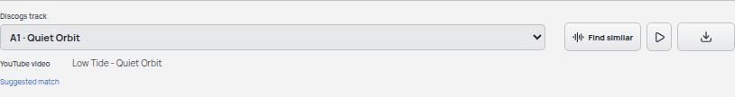
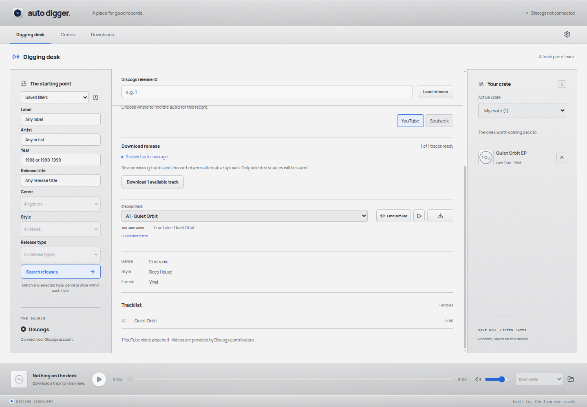
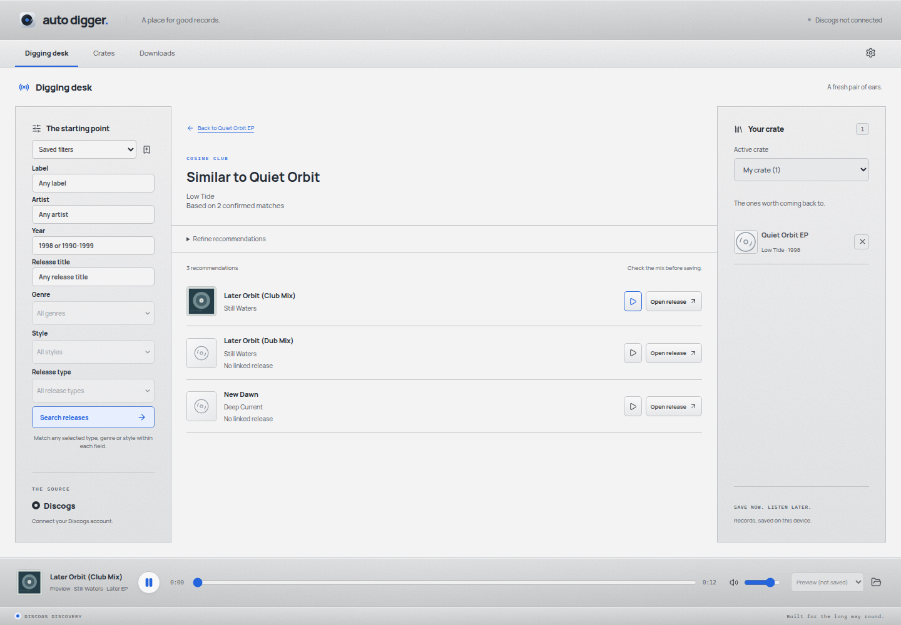
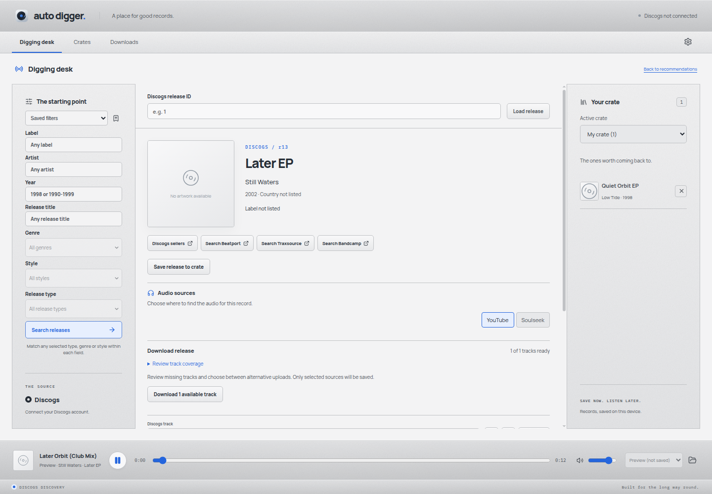
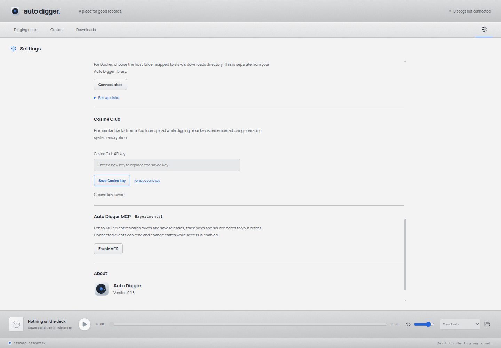
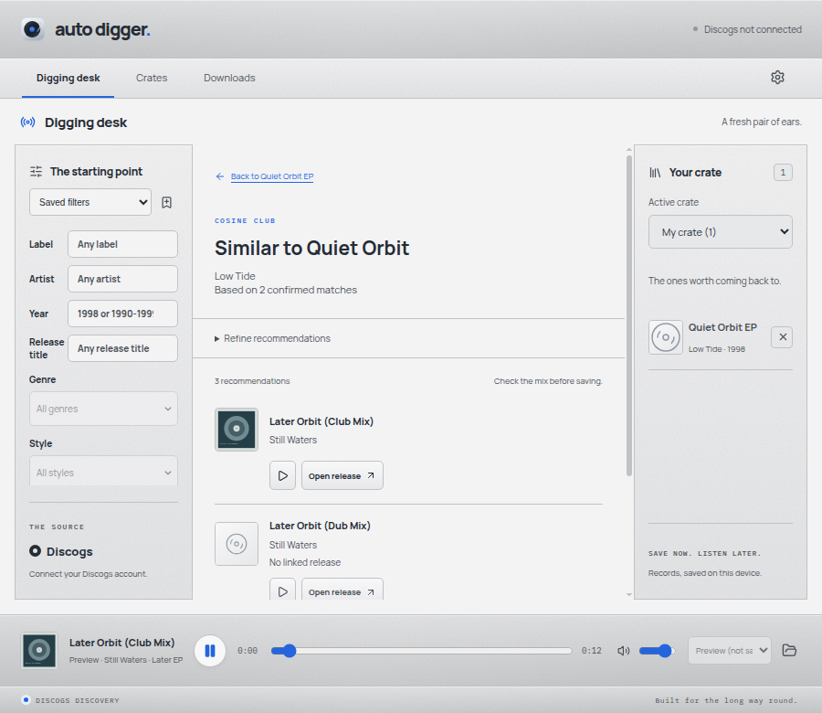
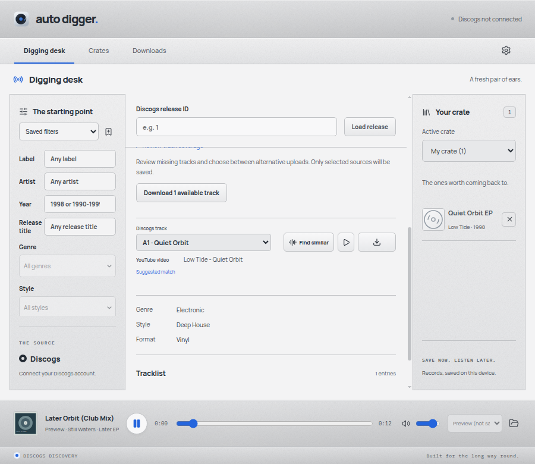

# Production Cosine recommendations verification

Verified on Linux with the built Electron application. The feature branch starts from dev and has no prototype flag, API lab, Beatport client or Bandcamp client. The separate local playground also combines the four pending UI PRs for the user's demo.

## Exercised journeys

- Save a masked Cosine key in Settings; clear the input after saving, retain it encrypted across restart and forget it explicitly. The fixture uses synthetic OS encryption; actual desktop keyring access still depends on the user's desktop session.
- Open a saved EP and choose the visibly labelled Find similar button beside its preview/download actions. See full mix titles, deduplicated uploads and explicit unavailable controls for a missing linked release.
- Linked release covers load progressively, with one lookup per distinct pressing in sequence. Preview/open share pending metadata for the same recommendation. Failed lookups can retry, and dismissing the journey stops the remaining queue and ignores late cover metadata. The existing RecordArtwork component handles missing or broken images.
- Artist/title search runs before the YouTube lookup. The native fixture confirms that both sources contribute, repeated recommendations collapse, and a shared Cosine identity makes only one similarity request. Unit checks reject unrelated mix hits, exclude conflicting recordings and preserve available results when one request fails.
- Refine years only when Refresh is chosen. Preview without creating a download, open the linked pressing, and use the normal Download action. The native test checks one audio fetch, the saved metadata, ID3 style genre and configured folder hierarchy.
- Return from a linked EP to recommendations with refinement retained, then to the original EP with digging filters retained. Dismissing a request ignores late completion. Provider failure stays readable and allows returning to the EP.
- Manually exercised the rendered desktop at 1440 by 1000 and 900 by 780, inspected screenshots and checked for horizontal overflow and visible alerts. Fixed the credential field's intrinsic width after inspecting its actual layout.

The screenshots use synthetic catalogue/API data and audio to keep the demo deterministic and avoid publishing private account or crate information. Public metadata resolution uses the real application's fixed Discogs boundary. Separately verified the production API live with the saved key: Billabong returns ten recommendations using artist/title plus YouTube, and still returns ten when the control uses an unindexed upload. The user's earlier I Love You (Dub) lookup has no confirmed match from either route. The live desk shows ten results without an alert. Live screenshots containing the user's profile stay local and are not published here.

## Screenshots

