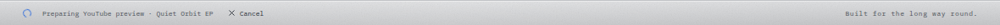
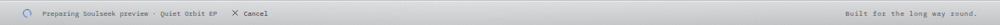
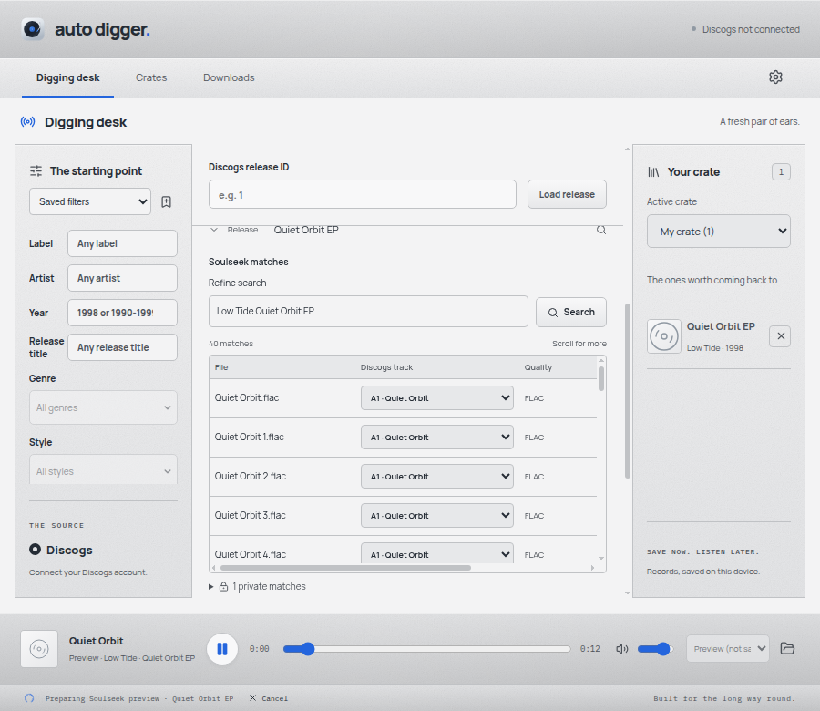

# Preview footer spinner verification

This focused change depends on the footer foundation in PR #82. It reuses the existing Lucide LoaderCircle and source-spinner animation/reduced-motion styling. No dependency or new loading state is added.

Manually exercised the built Electron application with synthetic catalogue/audio and the local slskd fixture:

- Started a delayed YouTube preview, inspected its running spinner and Cancel action in App status, then confirmed the spinner disappeared when playback started.
- Started a queued Soulseek preview, inspected the same footer indicator and cancelled the request. The spinner disappeared after cancellation.
- Inspected the rendered footer at 1180x860 and 900x780. The narrow window had no horizontal document overflow.
- Enabled reduced motion: the loading indicator remained visible with animation disabled.

Renderer regression checks cover completion, cancellation and failure. The native journey checks a visible indeterminate progress indicator across provider/page changes, running animation, reduced-motion styling and removal after cancellation/completion. Existing preview status text remains a live status announcement; no fabricated percentage is shown.

