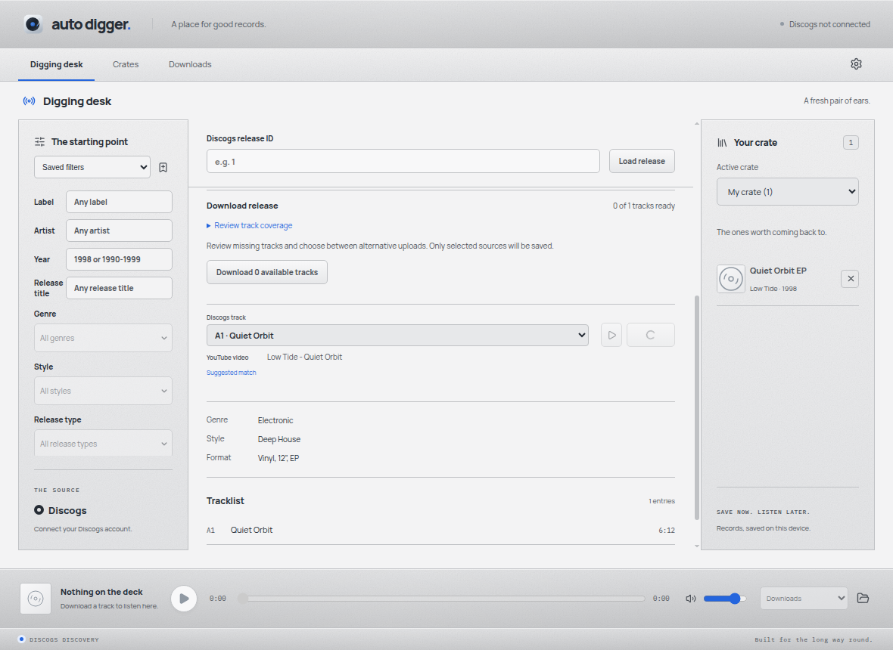
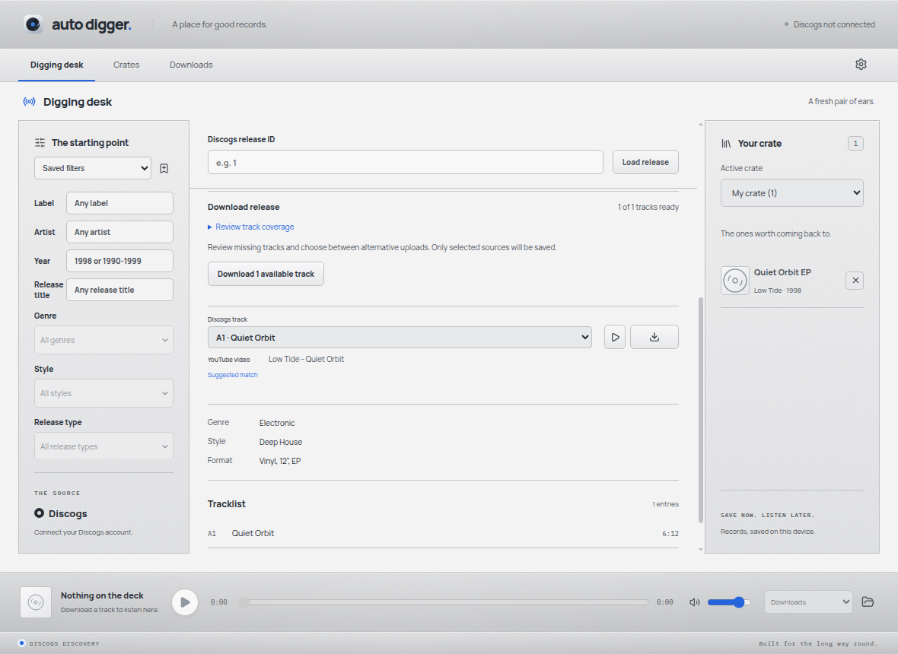
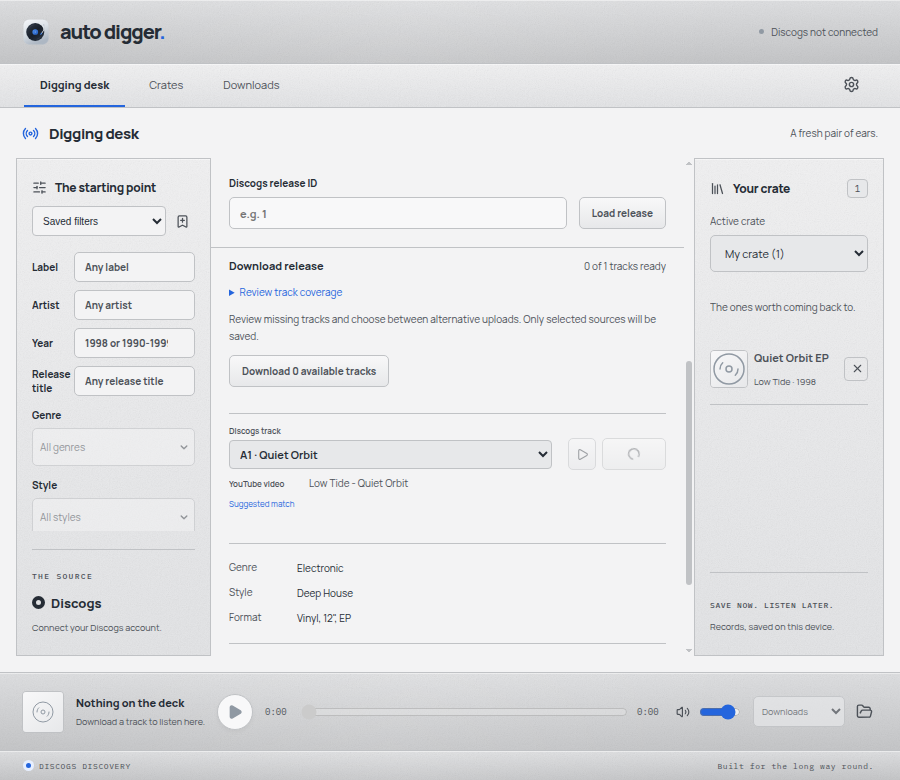

# Source availability spinner

The YouTube availability check now uses the existing Lucide LoaderCircle and
source-spinner animation inside the fixed-width download button. The previous
Checking text added a sibling to the action group and competed with its controls
for space. No dependency or animation framework was added. The existing
reduced-motion rule disables rotation.

## Regression coverage

- A deferred renderer probe exercises loading, success, failure and retry through
  the digging desk. Loading is accessible as an indeterminate progressbar, and
  the download control stays disabled until the source is available.
- Native Electron checks at 1180px and 900px compare the exact bounding boxes of
  the track selector, preview button and download button before and after a
  delayed successful check. They also check rotation, reduced-motion behavior
  and successful playback after the check.
- Both tests failed against the original implementation before the fix.

## Manual demo

A separate Electron session used the production build with a synthetic crate,
fixture audio tools and a delayed availability probe. It exercised opening an EP,
loading at 1180px and 900px, reaching the ready state and starting a temporary
preview. The selector and action button bounds were identical before and after
the check. Preview playback left the saved audio library empty.

These screenshots show the actual rendered desktop app with fixture metadata.
They demonstrate layout and interaction behavior; they do not measure a live
YouTube request.

